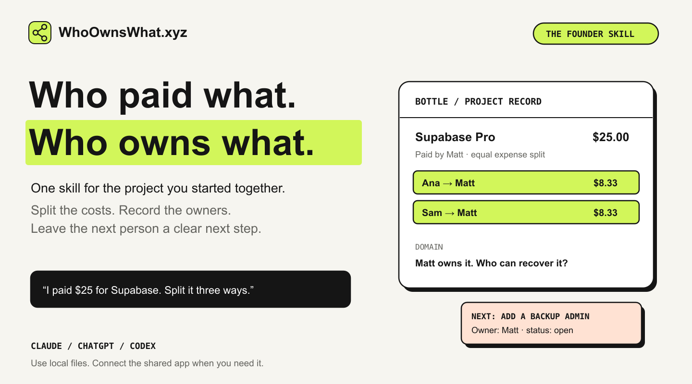
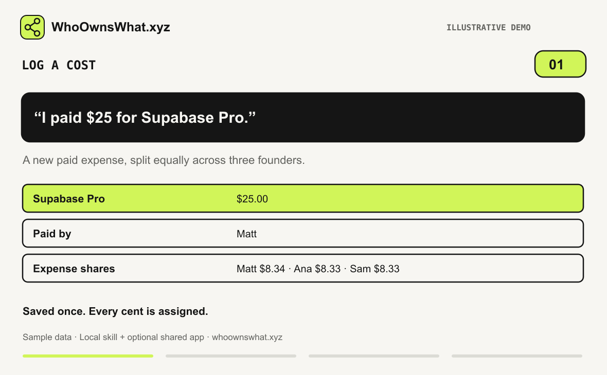
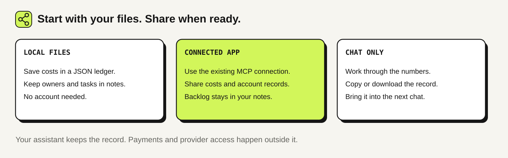

<p align="center">
  <a href="https://whoownswhat.xyz"></a>
</p>

# WhoOwnsWhat — the founder skill

Your co-founder bought the domain. You pay for hosting. Nobody remembers whose email recovers the Stripe account.

Tell your AI what happened. Keep a record of the costs, who owes whom, who controls each account, and what needs doing next.

**Free skill for Claude, ChatGPT and Codex. No account needed for local use.**

[Download the skill ZIP](dist/whoownswhat.zip) · [Copy the portable prompt](dist/CHATGPT.md) · [Open the full shared app](https://whoownswhat.xyz/app) · [MCP connection guide](https://whoownswhat.xyz/mcp)

## Try it

```text
We’re building Bottle: Matt, Ana and Sam. USD, equal expense shares.
Set up our ledger and ownership notes.

Matt paid $25 for Supabase Pro today. Log it as a monthly cost.

What do Ana and Sam owe Matt?

Only Matt can recover the domain. Add a task for Matt to give Ana
backup access at the registrar and verify it works.
```

The local ledger assigns $8.34 to Matt and $8.33 each to Ana and Sam. Ana and Sam each owe Matt $8.33. The access change stays an open task until someone actually makes and checks it.

## A 13-second example



*Illustrated demo with sample data, inspired by the [public product demo](https://whoownswhat.xyz/#demo-title). It explains the workflow; it is not a recording of a live account. [Static version](assets/demo-1.png). Payments and provider permissions happen outside the skill.*

## Five useful jobs

| Say this | Get this |
| --- | --- |
| “I paid $20 for Cursor. Log it.” | A saved cost, exact expense shares and the updated balance |
| “Who owes whom?” | A balance check that leaves the record unchanged |
| “Who can recover the domain?” | The recorded account owner, backup access and missing information |
| “Put this in our backlog. Ana owns it.” | A task with an owner, status and clear next action |
| “Sam is leaving. What needs to move?” | An ordered handover checklist with blockers and verification steps |

The backlog is a small Markdown file maintained by the skill. It is not a feature exposed by the current WhoOwnsWhat MCP server.

## Install

### Claude

Download [whoownswhat.zip](dist/whoownswhat.zip). In Claude, open **Customize → Skills → + → Create skill → Upload a skill**, upload the ZIP and enable it. Availability depends on your plan and workspace settings. The ZIP contains one `whoownswhat/` folder with `SKILL.md` at its root. [Official instructions](https://support.claude.com/en/articles/12512180-use-skills-in-claude).

For Claude Code, copy the contents of that `whoownswhat/` folder into your project's `.claude/skills/whoownswhat/` directory.

### ChatGPT

For the ChatGPT desktop app's standalone Skills support, ask its skill creator to import the supplied `whoownswhat/` folder. Use `@` to select the installed skill. Installation options depend on the host and workspace. [Official skill documentation](https://learn.chatgpt.com/docs/build-skills?product=breeze).

For an ordinary chat or Project, copy [the portable instructions](dist/CHATGPT.md) into the conversation and attach your existing records, if any. This is a prompt fallback, not a native installation. Without file tools, it produces a record to copy or download rather than a permanently saved ledger.

### Codex

Ask Skill Installer:

```text
Install the skill at the root of https://github.com/matt-warchol/whoownswhat-skill
```

Then ask `$whoownswhat` to set up your project. Or copy the ZIP's `whoownswhat/` folder into your configured skills directory. No paid API or extra Python packages are needed for local money calculations.

## Pick where your records live



| | Local skill | Full WhoOwnsWhat app |
| --- | --- | --- |
| Costs and reimbursements | A private JSON file; Python 3.9+ | A common project ledger, web UI and MCP |
| Ownership | Notes with explicit unknowns | A shared register with recorded access and risk flags |
| Backlog and decisions | A Markdown notes file | Keep using the skill's notes; no task MCP action |
| Collaboration | Share files yourself; one writer at a time | Member invitations and a common live record |
| Founder records | Ordinary notes only | Dated snapshots with member confirmations in the app |
| Persistence | Keep the files and bring them to the next chat | Saved in the service after a successful write |

The skill never silently syncs local files with the app. It does not collect your project data or call home. Connected mode sends only the requested tool operations to the project you connected.

**Want everyone looking at the same record? Use [WhoOwnsWhat.xyz](https://whoownswhat.xyz).** See the site for current plans and pricing; the skill itself is free.

## Connect the shared app

1. [Create or open your project](https://whoownswhat.xyz/app).
2. Open its **Connect** tab and generate a project token.
3. Configure the MCP connection in a client that supports bearer authorization headers. Keep the token in the client's connection settings, outside chat, notes and Git.
4. Ask for a project overview, then log a cost.

The endpoint is `https://whoownswhat.xyz/api/mcp`. The existing server exposes nine actions through one `wow` tool. The skill uses that connection if available; installing the skill alone does not connect an account. Claude Code and Cursor are documented by the product. Other hosts need compatible authentication support. [Connection details and action map](references/mcp.md).

Project creation, invitations, split changes, editing costs and founder confirmations stay in the web app. The current MCP interface does not expose those operations.

## Local files you keep

The assistant uses the included standard-library helper for exact money calculations and saves:

```text
my-project/
├── project.ledger.json    # expenses, allocations and completed reimbursements
└── project-notes.md       # ownership, backlog, decisions and handover
```

Save these outside this public repository. Keep the latest files and supply them in a new chat. The skill does not rely on the assistant remembering a previous session. [Commands and local limitations](references/local.md).

The helper supports one of USD, EUR, GBP or PLN per ledger. It rejects negative expenses, fractions of a cent, unknown payers and overpayments. Stable operation keys make identical retries safe; distinct keys still need a duplicate check. Costs keep their original allocations. Changing membership or splits needs a reconciled new period or the full app.

## Check the package

```sh
python3 -m unittest discover -s tests -v
python3 tools/package.py
```

The checks exercise exact three-person splits, partial and full reimbursements, retries, conflicting keys, invalid input, corrupt records and reads that do not modify the file. No live project is modified by the tests.

For behavioral review, use [the example scenarios](tests/SCENARIOS.md). Live MCP authentication and native installation should be tested in your own host before team rollout.

## What's inside

- [SKILL.md](SKILL.md): the workflow and its boundaries.
- [scripts/ledger.py](scripts/ledger.py): the local money ledger; no dependencies beyond Python.
- [references/](references/): local operation and the actual MCP contract.
- [templates/project-notes.md](templates/project-notes.md): the ownership and backlog record.
- [assets/](assets/): original editable graphics, a GIF and a static fallback.
- [dist/](dist/): the uploadable skill and a single-file prompt fallback.

## Credits and license

Built for [WhoOwnsWhat.xyz](https://whoownswhat.xyz), by [Matt](https://x.com/mwarcholinski).

The [Reddit Founder Skill](https://github.com/piupiuyao/reddit-founder-skill) inspired the idea of releasing a useful free skill alongside a full product. These instructions, helper and visuals were written for WhoOwnsWhat; no Reddit skill content or private application code is bundled.

[MIT](LICENSE). Expense records are not equity agreements or legal transfers.
